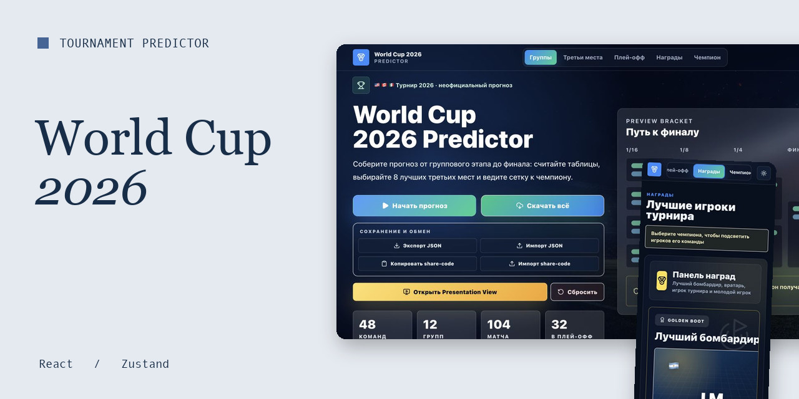
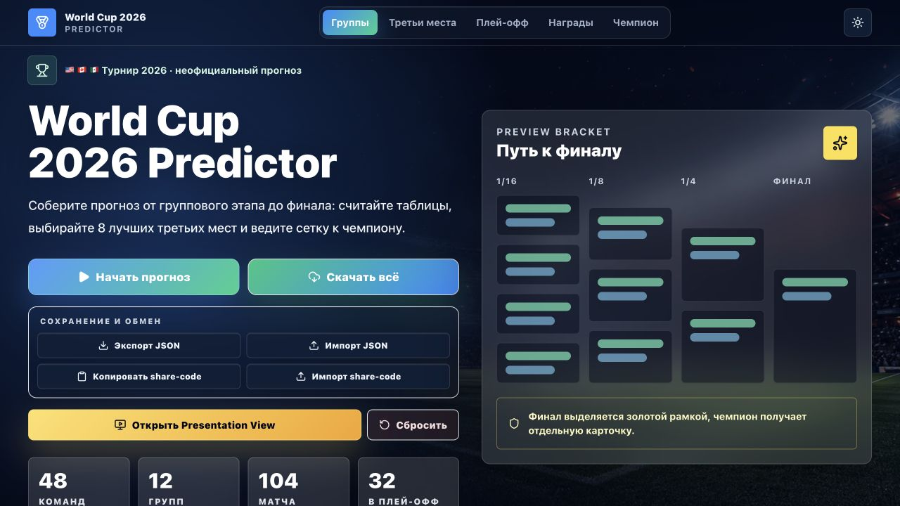
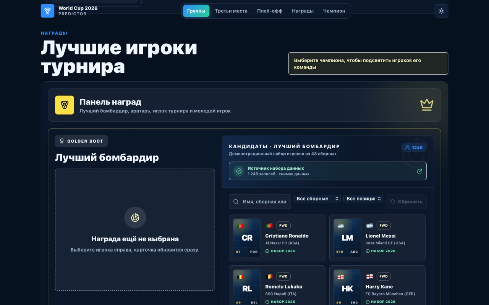
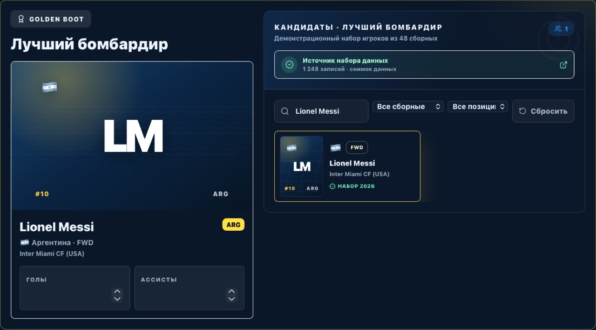
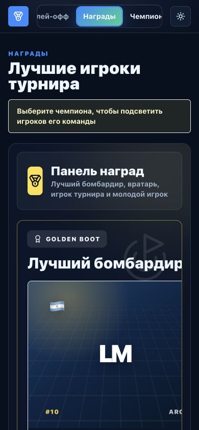

<a href="README.md"><picture><source media="(max-width: 600px)" srcset="https://raw.githubusercontent.com/mrjakeball/mrjakeball/main/assets/navigation/ru-on-compact.svg?v=3"></picture></a>
<a href="README_EN.md"><picture><source media="(max-width: 600px)" srcset="https://raw.githubusercontent.com/mrjakeball/mrjakeball/main/assets/navigation/en-off-compact.svg?v=3"></picture></a>
<a href="https://github.com/mrjakeball/portfolio"><picture><source media="(max-width: 600px)" srcset="https://raw.githubusercontent.com/mrjakeball/mrjakeball/main/assets/navigation/catalog-ru-compact.svg?v=3"></picture></a>

# World Cup 2026 Predictor

Конструктор футбольного прогноза. Результаты групп определяют участников плей-офф, а итоговый прогноз можно сохранить, экспортировать или передать через share-code.

Опубликованная демоверсия · Публичная витрина приватного проекта  
React · TypeScript · Vite · Zustand · Vitest

## Что меняется после правки результата

Zustand связывает групповые таблицы, рейтинг третьих мест и сетку плей-офф. Сохранения остаются в браузере, а миграции учитывают изменения формата данных.

**Тестирование.** В документации проекта зафиксировано 26 тестов Vitest. Они охватывают расчёт таблиц и сетки, восстановление прогноза, данные игроков, share-code и экспорт.

Независимый фан-проект. Составы и награды на экранах иллюстрируют работу конструктора.

## Как посмотреть демоверсию

**[Начало прогноза](assets/screen-tournament-start.jpg)** · Стартовая страница показывает путь к финалу. Чтобы увидеть связь таблиц и сетки, начните с результатов группового этапа.

**[Индивидуальные награды](assets/screen-awards-desktop.jpg)** · После командного прогноза можно перейти к игрокам. На экране открыта номинация лучшего бомбардира.

**[Выбранный игрок](assets/screen-player-selected.jpg)** · Карточка слева показывает выбор для конкретной номинации. Это часть пользовательского прогноза.

Развернуть галерею

[Примечание о проекте](NOTICE.md) · [Профиль](https://github.com/mrjakeball) · [Каталог проектов](https://github.com/mrjakeball/portfolio)
