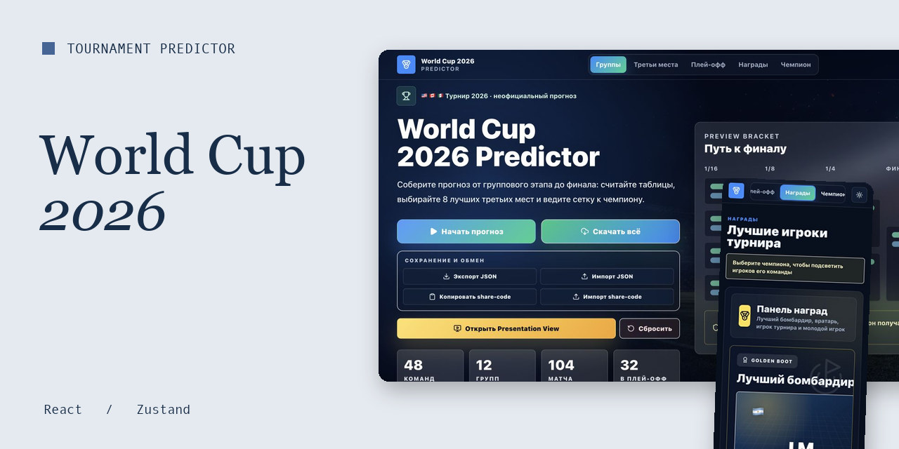
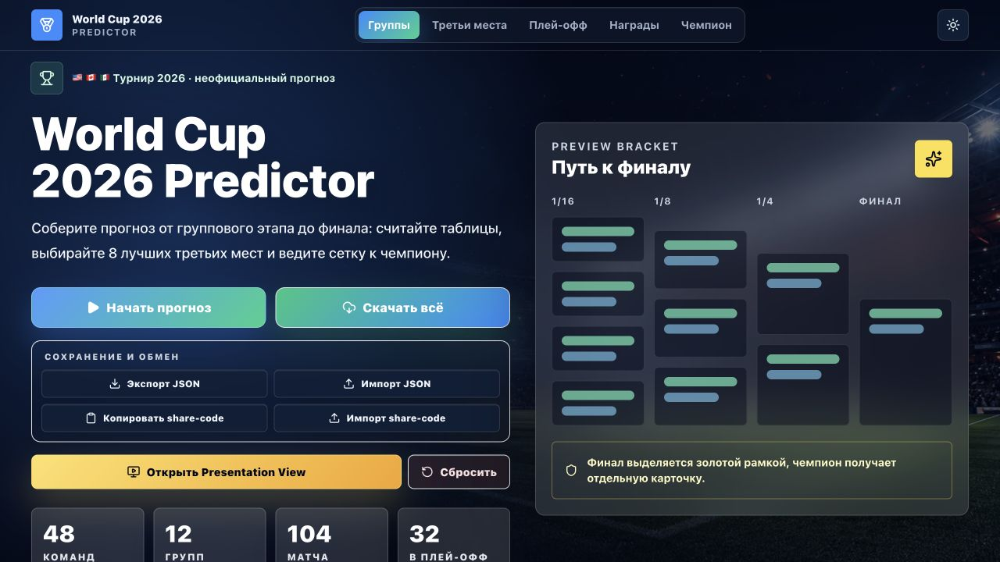
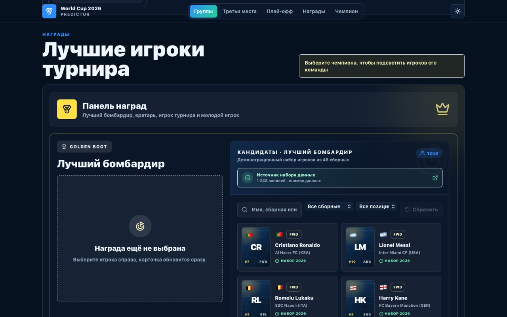
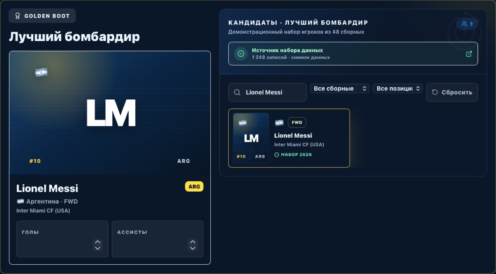
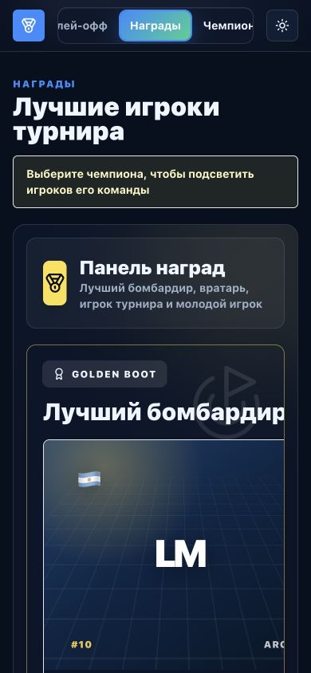

# World Cup 2026 Predictor

A football tournament predictor. Group results determine the knockout field, and a finished prediction can be saved, exported or shared as a code.

[Open the predictor ↗](https://courageous-elf-34b597.netlify.app/)

Published demo · Public showcase of a private project  
React · TypeScript · Vite · Zustand · Vitest

## What changes when a score changes

Zustand connects group standings, third-place rankings and the knockout bracket. Saves stay in the browser, with migrations for changes to the data format.

**Testing.** The project documents 26 Vitest tests covering standings, knockout generation, save restoration, player data, share codes and export.

An independent fan project. Rosters and awards in the screenshots illustrate the prediction workflow.

## A route through the live demo

**[Starting a prediction](assets/screen-tournament-start.jpg)** · The landing page outlines the route to the final. Start with group results to see how standings feed into the bracket.

**[Individual awards](assets/screen-awards-desktop.jpg)** · The player awards accompany the team prediction. This view shows the top-scorer category.

**[Selected player](assets/screen-player-selected.jpg)** · The card on the left shows the pick for that award as part of the user’s prediction.

View the gallery

[Project notice](NOTICE.md) · [Profile](https://github.com/mrjakeball/mrjakeball/blob/main/README_EN.md) · [Project catalogue](https://github.com/mrjakeball/portfolio/blob/main/README_EN.md)
